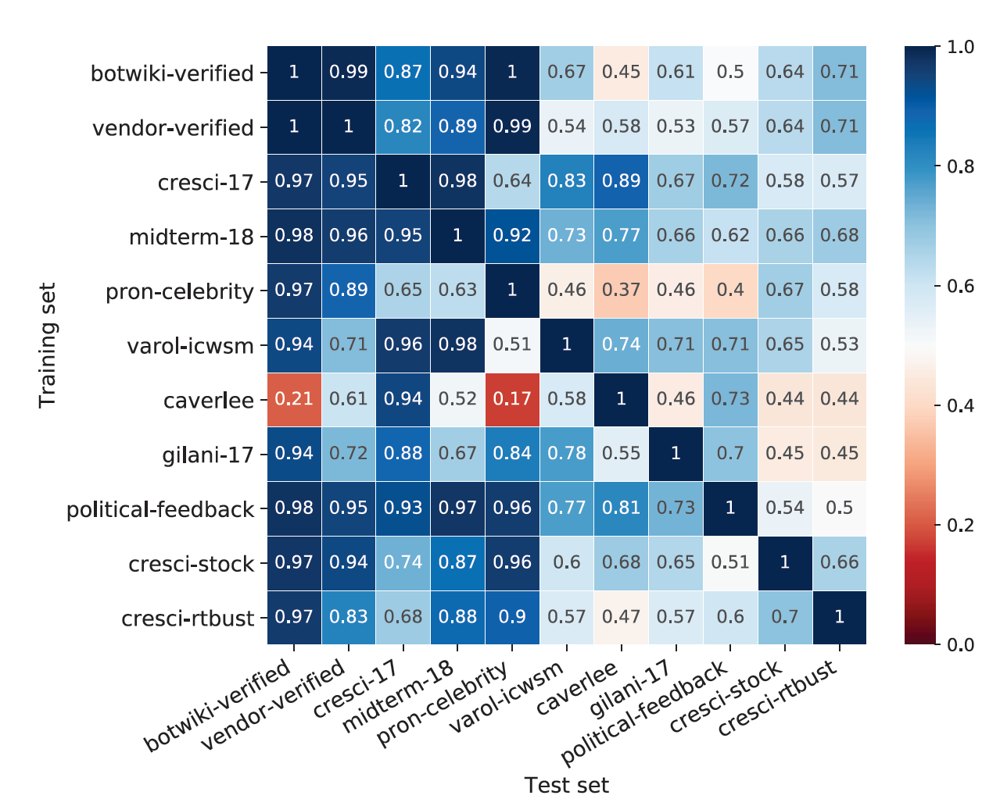
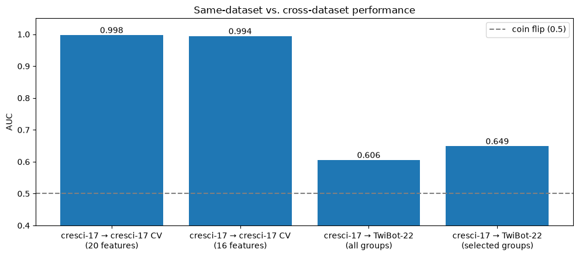
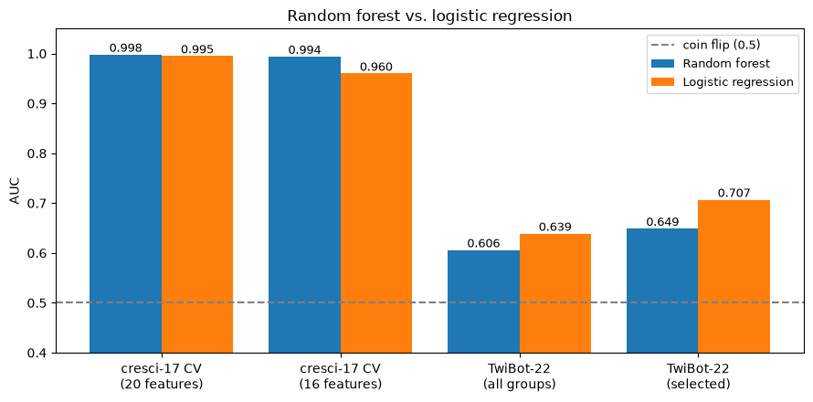
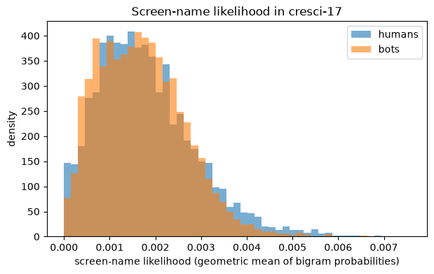
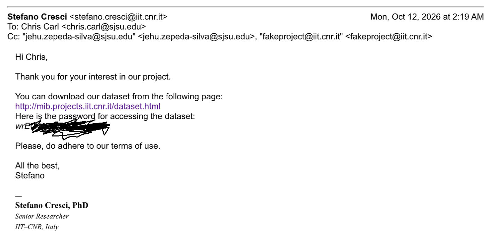
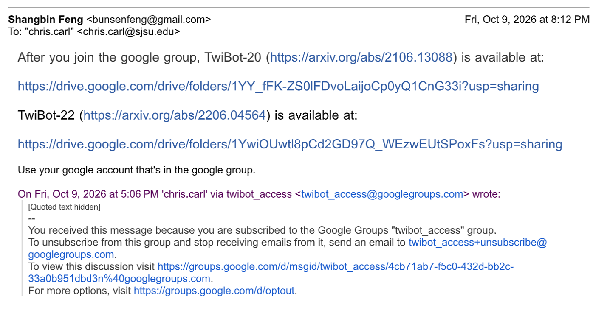

# Main Presentation
"Replication Study: Generalizing Social Bot Detection"

- Authors (CZ)
    - [Chris Carl](mailto:chris.carl@outlook.com)
    - [Jehu Zepeda-Silva](mailto:jehu.zepeda-silva@sjsu.edu)

## Paper
[Scalable and Generalizable Social Bot Detection through Data Selection](https://doi.org/10.1609/aaai.v34i01.5460)

- Authors
    - Kai-Cheng Yang
    - Onur Varol
    - Pik-Mai Hui
    - Filippo Menczer

## Findings
- Big

    "No dataset can generalize well on other datasets."

    CONFIRMED - `cresci-17` did not generalize well to `twibot-22`

    "Selection is a promising direction for dealing with noisy training data."

    CONFIRMED - `cresci-17` could be data selected to improve generalizability.

    |Test                      |Features|AUC      |
    |---                       |---     |---      |
    |cresci-17 cross-validation|20      |0.998    |
    |cresci-17 cross-validation|16      |0.994    |
    |cresci-17 → TwiBot-22     |16      |**0.606**|

- Small

    Screen Name Likelihood was not a contributing feature

    CONFIRMED - `cresci-17` could be data selected to improve generalizability.

## Yang - Process
- Collect a bunch of datasets

    `caverlee`, `varol-icwsm`, `cresci-17`, `pronbots`, `celebrity`, `vendor-purchased`, `botometer-feedback`, `political-bots`, `gilani-17`, `cresci-rtbust`, `cresci-stock`, `midterm-18`, `botwiki`, `verified`

    Focus on the user metadata and telemetry, not tweet content.

- Feature select and engineer

    Using status, follower, friends counts and other boolean flags, engineer new features like likelihood, lengths, and rates.

- Train a Random Forest of 100 trees

    Using 5-fold CV.

    Each dataset will have a model mapped to it.

- Test on all other datasets

    Each dataset's model will test against all other datasets.

## Yang - Definitions
- seperability - AUC averaging across columns
- generalizability - AUC averaging across rows
- likelihood - geometric mean of a username's bigram probabilities
- SHAP Values - describes each feature as more human-like or more bot-like

## CZ - Process
- Collect a bunch of datasets (partial recreation)

    We collected 2 datasets, one original, `cresci-17`, and one not in the original, `twibot-22`.

- Feature select and engineer (partial recreation)

    Recreated the 20 features for `cresci-17`.

    We *couldn't recreate* all 20 engineered features in `twibot-22` due to a lack of source base features.

- Train a Random Forest of 100 trees

    Fully recreated.

- Test on all other datasets (not recreated)

    We only had 2 datasets, so most we could do was pitting them against each other.

    

## CZ - Improvements
- Entirely new dataset, `twibot-22`

    Including this dataset highlighted the original conclusion that (a) data doesn't generalize well to other data, and (b) illustrates a flaw in feature engineering as a means to scale bot detection because the same features couldnt be engineered.

- LOGO (Leave One Group out)

    The original `cresci-17` dataset could have been further data selected to identify the best dataset to train on that would generalize better. Leaving out most spam examples improved generalizability.

    

- Other Model

    We also trained a Logistic Regression. The original paper stuck to only a Random Forest with 100 trees.

    

## Yang - Weaknesses
- Data selection did not include understampling to address class imbalance.

    Yang took the data as is or forgot to mention addressing the class imbalances.

- Feature engineering works on same-featured data.

    New data may not have the same features as before. It may have new features.

- N-Gram Likelihood was not well defined

    We do not know what the corpus of text was that produced the PDF. We invented our own corpus, the totality of human usernames in the `twibot-22` dataset.

    We also determined that the distribution is nearly identical in the `cresci-17` dataset, calling into question the original methodology that suggested it was important at all.

    

- Evaluation metric choice was not discussed

    The choice of F1 was not discussed. It would be better to have used Recall, which penalizes false negatives more.

    E.g. it is worse in a bot detection algorithm to let a bot "slip through the cracks" and cause information manipulation than for a human to answer how many fire hydrants.

- Random Forest of 100 trees without pre-pruning is a strange choice

    Yang said their "proposed framework does not aim to provide a more expressive algorithm; we will stick with random forest".

    But why chose an algorithm that is prone to overfitting?

    At least try two algorithms or one with pre-pruning or less trees or something?

## CZ - Weaknesses
- Datasets count

    We only requested access to two datasets--one from the original paper, `cresci-17`, and the other not, `twibot-22`.

    Better would have been to ask for two datasets from the original, keeping `twibot-22`.

- No baseline

    Yang employed the `botometer` API to compare each dataset model against. It would have been good to include its usage, but it is rate limited to 5000 users per month, and the twibot dataset alone has 1000000.

- Seperability / Generalizability

    We did not attempt to characterize or evaluate the seperability or generalizability of our datasets. We only used two datasets, and their sep/gen calculation requires an average of AUC across the grid.

## Takeaways
- Datasets are licensed, data isn't free.

    "Doing it right" is hard. In a learning context, datasets are usually provided to you free of charge. In a research context, money and licensing becomes a factor.

    In our case, we messaged the researchers who generated the original datasets, and they were gracious enough to grant access.

    

    

    Getting a high quality service as a baseline would have costed money. 50 dollars for one month isn't much in the grand scheme, but dollars are dollars.

- Cleaning is hardest part

    By far. Takes the longest, even compared to waiting around for the training to finish.

- Every paper has weaknesses.

    Yang's paper isn't bulletproof. It has oversights, assumptions taken for granted, and doesn't pre-emptively defend itself against all possible scrutiny.

    We were able to identify areas we could replicate Yang's work and areas we could improve.

## Special Thanks and Datasets
- Researchers
    - [Dr. Stefano Cresci](mailto:stefano.cresci@iit.cnr.it), Instituto Informatica Telematica, CNR
    - PhD Candidate [Shangbin Feng](mailto:shangbin@cs.washington.edu), University of Washington
- Dataset Access Request Locations
    - [`cresci-17`](http://mib.projects.iit.cnr.it/dataset.html)
    - [`twibot-22`](https://groups.google.com/g/twibot_access)
